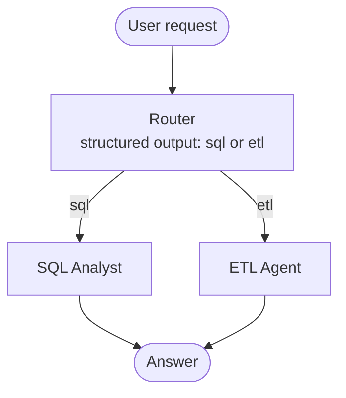
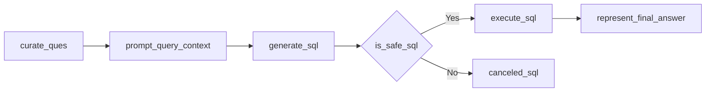

# PipeQL Agent

Ask in plain English. PipeQL Agent decides whether your request is a **question about your data** or an **ETL job**, then hands it to a specialist AI agent that either writes and runs a read-only SQL query against PostgreSQL, or extracts data from an API and transforms it with Pandas.

Built with **LangGraph**, **Claude** (via `langchain-anthropic`), **PostgreSQL 16** in Docker, and **Pandas**.

```
 ❯ Which 5 cities have the most active users?

 ● SQL Analyst
   The top 5 cities by active users are ...

 ❯ Extract the marketstack stock prices and save them as csv

 ● ETL Agent
   The stock prices were saved to data/extract/marketstack_20261108_173935.csv
```

---

## How it works

PipeQL Agent is three LangGraph graphs: a router graph on top, which calls one of two agent graphs.



### Router (`agents/data_agent.py`)

Reads the request and classifies it as `sql` or `etl` using a Pydantic `RouterSchema` with structured output, so the decision is always one of two valid values plus a short reason. It never answers the request itself.

### SQL Analyst (`agents/sql_analyst.py`)

A fixed pipeline that turns a question into a safe, executed query:



| Node | What it does |
|---|---|
| `curate_ques` | Rewrites the question to be clear and unambiguous. |
| `prompt_query_context` | Reads the live schema from Postgres (tables, columns, types, constraints, indexes, and 5 sample rows per table) and builds the prompt. |
| `generate_sql` | Writes a PostgreSQL query (limited to 10 rows unless you ask for more). |
| `is_safe_sql` | An LLM judge checks that the query only reads data. Anything that writes or changes the database (`INSERT`, `UPDATE`, `DELETE`, `DROP`, `ALTER`, ...) is rejected. |
| `execute_sql` | Runs the query as a **read-only** database role. |
| `represent_final_answer` | Turns the raw rows into a readable answer. |

**Two layers of protection.** The LLM judge is the first check, but an LLM can be wrong. The real guarantee is the database: the agent connects as a role with only `SELECT` grants and `default_transaction_read_only = on`, so Postgres itself refuses any write, even if a bad query got past the judge.

### ETL Agent (`agents/etl_agent.py`)

A tool-calling loop: the LLM picks a tool, the tool runs, the result goes back to the LLM, and this repeats until the job is done. One request can chain several tools, e.g. "extract, then transform that file".

| Tool | What it does |
|---|---|
| `extract_load_tool` | Calls a REST API and saves the records to `data/extract/` as CSV, JSON, or Parquet. |
| `transform_load_tool` | Shows the LLM the first rows of a file, has it write Pandas code for your transformation, runs that code, and checks that the output file really was written to `data/transform/`. |

**Named sources** (`utils/api_sources.py`) let the agent ask for a source by name instead of a URL. API keys are added from the environment at call time, so they never appear in the LLM prompt.

| Name | Data |
|---|---|
| `pokemon` | Pokemon list from PokeAPI (name, url). No key needed. |
| `marketstack` | End-of-day stock prices for AAPL and MSFT from Marketstack. Needs `MARKETSTACK_API_KEY`. |

Every extract and transform writes a **new** file named `<source>_<timestamp>.<format>` (e.g. `marketstack_20261108_173935.csv`), so earlier results are never overwritten.

### Model tiers (`utils/llm_pick.py`)

Each step uses a model sized to the job: `simple` steps (routing, rewriting the question, formatting the answer) use **Claude Haiku**, and `intermediate` steps (writing SQL, judging safety, ETL tool calls, writing Pandas code) use **Claude Sonnet**. A `complex` tier (**Claude Opus**) is available but not used by default.

Rendered diagrams of all three graphs are in [`graphs_png/`](graphs_png/).

---

## The sample database

`feed_db.py` creates and loads a ride-sharing database from the CSV files in `data/`:

| Table | Contents |
|---|---|
| `users` | Riders and drivers: name, email, phone, city, province, user type, signup date, active flag |
| `vehicles` | Drivers' vehicles: make, model, year, license plate, color, active flag |
| `rides` | Each trip: rider, driver, request/pickup/dropoff times, coordinates, distance, fare, surge multiplier, status, cancellation reason |
| `payments` | Payment for each ride: payer, amount, method, status, transaction ID, time |
| `ratings` | A rider's rating of a driver for a ride: score, comment, time |

---

## Getting started

### Prerequisites

- Python 3.13+ and [uv](https://docs.astral.sh/uv/)
- Docker with Docker Compose
- An [Anthropic API key](https://console.anthropic.com/)
- (Optional) A [Marketstack](https://marketstack.com/) API key for the stock prices source

### 1. Install dependencies

```bash
uv sync
```

### 2. Create `.env`

Create a `.env` file in the project root:

```env
ANTHROPIC_API_KEY=your-anthropic-key

# PostgreSQL
host=localhost
port=5432
database=rideshare
user=pipeql_reader            # read-only role, used by the SQL Analyst
password=change-me
admin_user=pipeql_owner       # owner role, used only by feed_db.py to load data
admin_password=change-me-too

# Optional
MARKETSTACK_API_KEY=your-marketstack-key
PIPEQL_AGENT_LOG_LEVEL=INFO   # DEBUG also logs full prompts
```

### 3. Start PostgreSQL

```bash
docker compose up -d
```

On every start, the container makes sure the database, the owner role, and the read-only role exist (see `docker/postgres/entrypoint.sh`). It reports healthy once the read-only role can log in.

### 4. Load the sample data

```bash
uv run python feed_db.py
```

### 5. Run PipeQL Agent

```bash
uv run python main.py
```

Type a request at the `❯` prompt. Type `q`, `quit`, or `exit` (or press Ctrl+D) to leave.

---

## Example prompts

**SQL Analyst**

- How many riders and how many drivers are there?
- For each payment method, what is the total amount collected and the average payment, counting only completed payments?
- What is the average driver rating for each vehicle make? Only include makes with at least 100 ratings.
- For each month, show completed rides, total fare, and cancellation rate, ranked by total fare, with the change from the previous month.

**ETL Agent**

- Extract the pokemon data from the PokeAPI and save it as csv.
- Transform `data/extract/<marketstack file>.csv`: keep only AAPL rows, add a `daily_range` column (high − low), and sort by date, newest first.
- For each symbol, add a daily return % and 5-day moving averages of close and volume. Save as parquet.
- Extract the marketstack stock prices, then build a weekly summary per symbol and compare AAPL and MSFT weekly returns.

---

## Logging

All agents write to one rotating log file, `logs/pipeql_agent.log` (5 MB per file, last 3 kept). Each line shows which agent wrote it, and every node logs when it starts, what it decided, and how long it took, so you can follow a request step by step:

```
2026-11-08 10:15:02 | INFO  | data_agent  | [route_edge] Decision: go to 'sql_node'
```

Set `PIPEQL_AGENT_LOG_LEVEL=DEBUG` to also log full prompts, including the database schema.

---

## Project structure

```
pipeql-agent/
├── main.py                  # Interactive terminal
├── feed_db.py               # Creates the tables and loads data/*.csv
├── agents/
│   ├── data_agent.py        # Router graph: sends each request to SQL or ETL
│   ├── sql_analyst.py       # NL-to-SQL graph with a safety judge
│   └── etl_agent.py         # Tool-calling ETL graph and its tools
├── utils/
│   ├── api_sources.py       # Named API sources and the HTTP client
│   ├── database.py          # Schema introspection and query execution
│   ├── etl_tools.py         # Extract, preview, and run generated Pandas code
│   ├── llm_pick.py          # Model tiers (Haiku / Sonnet / Opus)
│   └── logger.py            # Shared rotating log file
├── models/schema.py         # Pydantic state and output schemas
├── docker-compose.yml       # PostgreSQL 16
├── docker/postgres/         # Entrypoint that creates the roles and database
├── data/                    # Sample CSVs, plus extract/ and transform/ outputs
└── graphs_png/              # Rendered diagrams of each graph
```

---

## Limitations

- **Generated Pandas code runs without a sandbox.** The ETL agent runs LLM-written code with `exec()` in the same process. Use it only on your own machine with data you trust. Running the code in a container or subprocess is the next step.
- **No memory between requests.** Each request starts fresh, so follow-ups like "now sort that by date" don't know about the previous answer.
- **One sample database.** The router prompt describes the ride-sharing tables, so pointing the SQL Analyst at a different database also means updating that prompt.
